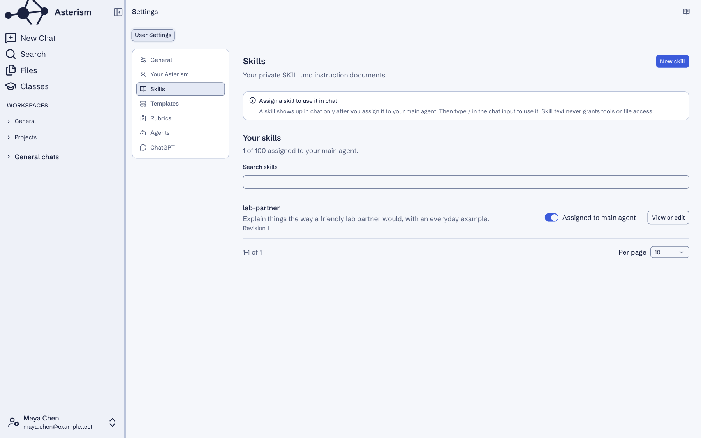
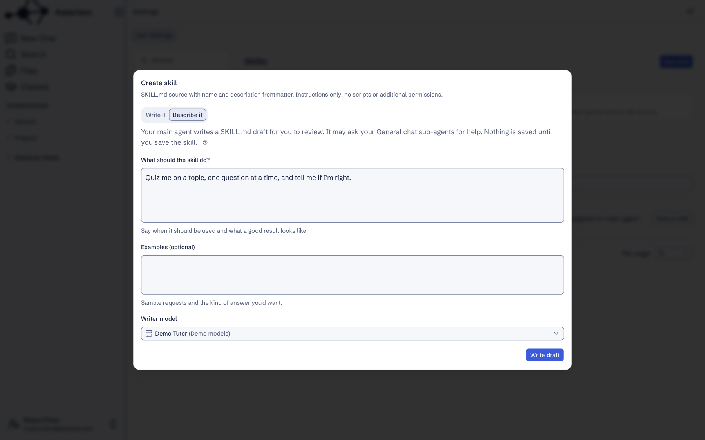
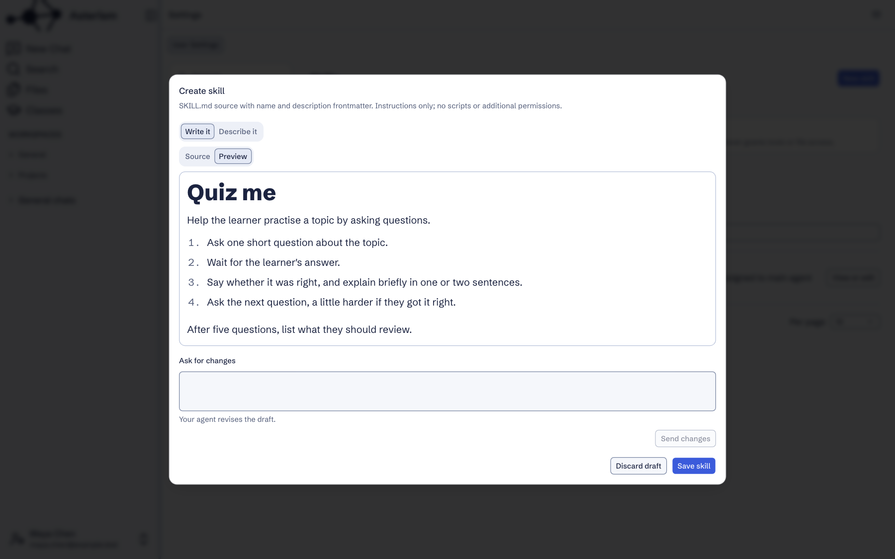

# Skills

A **skill** is a set of instructions you write once and switch on in any chat by
typing `/`, for example "explain things the way a lab partner would" or "quiz me
one question at a time". This page shows how to write one, have Asterism draft
one for you, and assign it so it shows up in chats.

> **Who can do this:** everyone, when your administrator has turned skills on.

## Your skills

Open **Settings** › **Skills**.

A skill only appears in chats when it's **assigned to your main agent**. Turn on
**Assigned to main agent** beside it. To change a skill, select **View or edit**.

## Write a skill yourself

1. Select **New skill**. The **Write it** tab opens with a template.
2. Fill in the template:
   - **name**: a short name in lowercase with hyphens, such as `quiz-me`. You type
     `/quiz-me` to use it.
   - **description**: one or two sentences on what it does and when to use it.
   - below the second `---` line, the instructions themselves.
3. Use **Preview** to see how it reads.
4. Select **Save skill**.
5. Turn on **Assigned to main agent** beside it.

## Have Asterism draft one

1. Select **New skill**, then the **Describe it** tab.
2. In **What should the skill do?**, say what you want, when it should be used and
   what a good result looks like. Add **Examples** if you like.

   

3. Choose a **Writer model**, then select **Write draft**.

   Your main agent writes a draft. It opens in the **Write it** tab.

   

4. Read the draft. Edit it yourself, or type what to change in **Ask for changes**
   and select **Send changes**.
5. Select **Save skill** to keep it, or **Discard draft** to throw it away.
6. Turn on **Assigned to main agent** beside it.

The draft is only a suggestion. Nothing is saved until you select **Save skill**.

## Good to know

- A skill only adds instructions. It never lets Asterism use tools or files it
  couldn't use already.
- Sub-agents can have skills too, chosen in the sub-agent's editor under
  **Skills**. A sub-agent loads a skill by itself when it fits the task; it
  doesn't use `/`. See [Agents](agents.md).
- Using a skill in a chat is explained in
  [Skills, prompt templates and the prompt coach](../02-chatting/skills-templates-and-the-prompt-coach.md).

## Related

- [Agents](agents.md)
- [Templates and rubrics](templates-and-rubrics.md)
