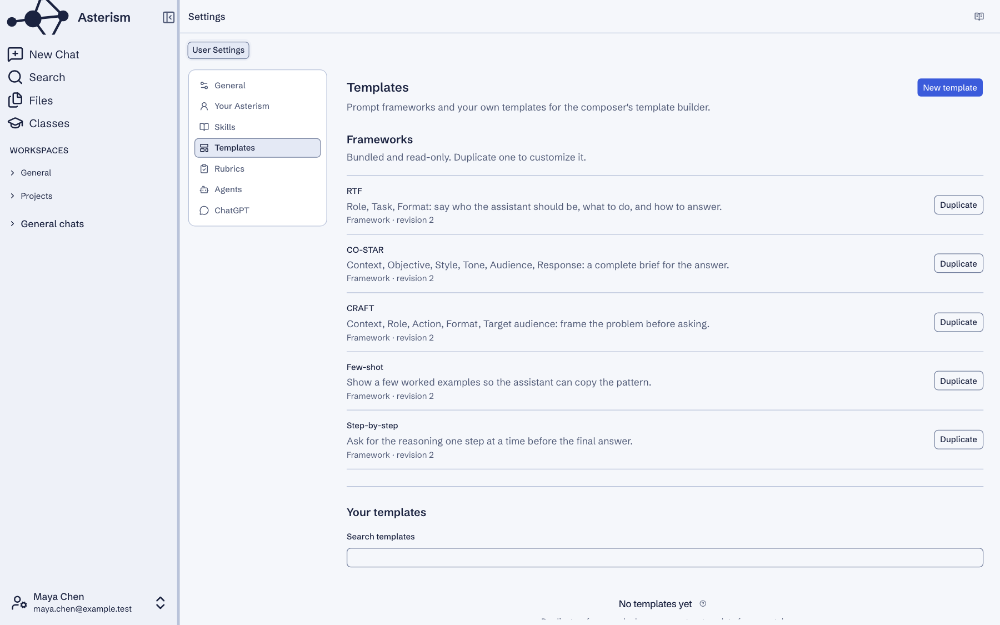
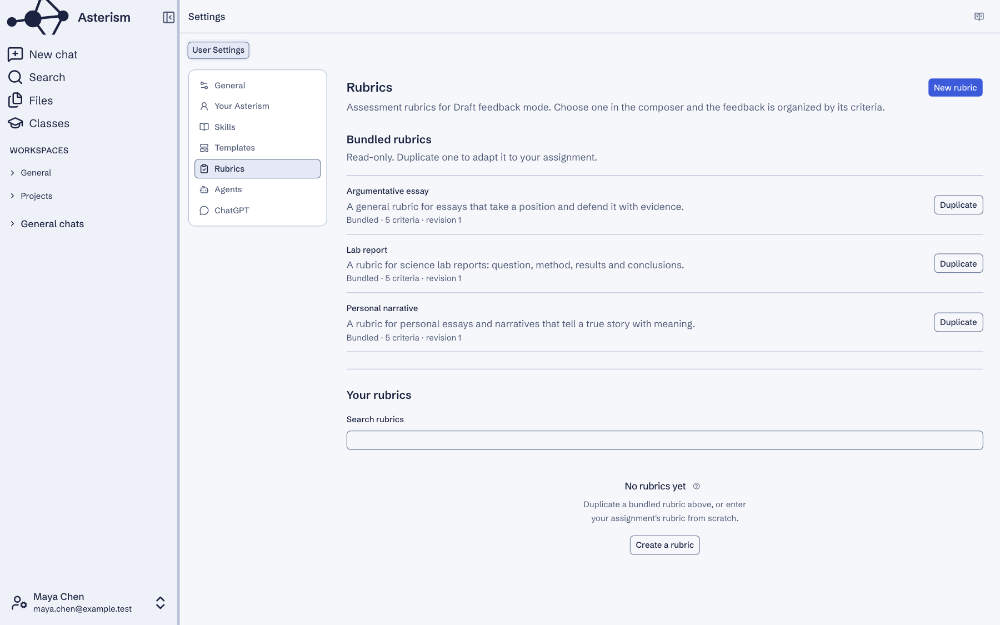

# Templates and rubrics

**Settings** › **Templates** and **Settings** › **Rubrics** hold the prompt
templates and rubrics you use in chats. Each comes with a few ready-made ones you
can copy and change.

> **Who can do this:** everyone.

## Templates

A [prompt template](../glossary.md) is a form that builds a clear message from a
few fields. Using one in a chat is explained in
[Skills, prompt templates and the prompt coach](../02-chatting/skills-templates-and-the-prompt-coach.md#build-a-message-from-a-template).

- **Frameworks** are the templates that come with Asterism. You can't change them,
  but you can **Duplicate** one to make your own copy.
- **Your templates** are the ones you made or duplicated.

### Make your own template

1. Select **Duplicate** beside a framework, or **New template** to start from
   scratch.
2. Give it a **Name** and **Description**.
3. Add the fields it should ask for with **Add field**, and write the
   **Prompt body**: the message it builds, with a placeholder for each field. The
   **Insert a placeholder** buttons add one at the cursor.
4. If you like, write a **Freeform checklist**: the reminders shown when someone
   uses the template with the least help.
5. Select **Save template**.

Your template now appears under **Your templates** in a chat's
**Prompt templates** window, and when you type `/` in the message box.

## Rubrics

A [rubric](../glossary.md) is what Draft feedback mode assesses your writing
against. Entering your assignment's rubric is explained step by step in
[Rubrics and draft feedback](../04-learning/rubrics-and-draft-feedback.md#use-your-assignments-own-rubric).

- **Bundled rubrics** come with Asterism: **Argumentative essay**, **Lab report**
  and **Personal narrative**. **Duplicate** one to adapt it.
- **Your rubrics** are the ones you made or duplicated. Search, edit or delete them
  here.

## Related

- [Skills](skills.md)
- [Rubrics and draft feedback](../04-learning/rubrics-and-draft-feedback.md)
