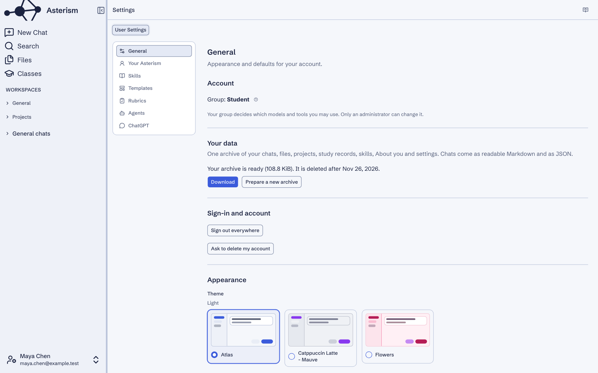
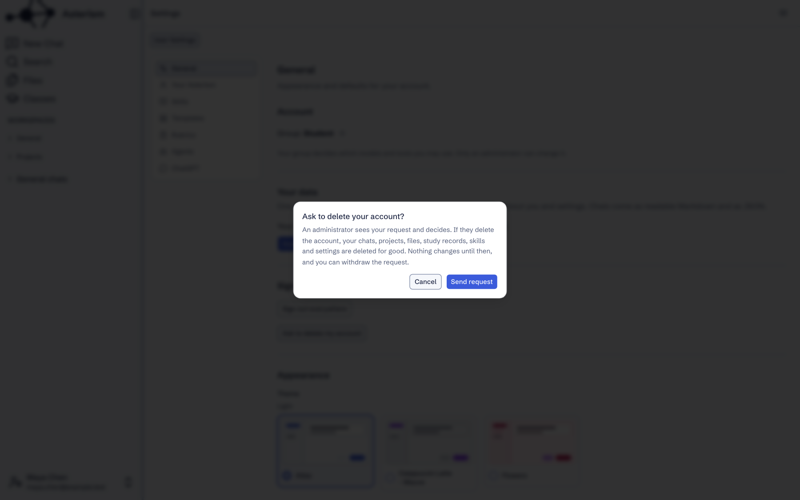

# Your data and your account

You can download a copy of everything your account holds, and ask for your
account to be deleted. Both are in **Settings** › **General**.

> **Who can do this:** everyone. Administrators can't ask to delete their own
> account; another administrator deletes it.

## Download your data

You get one archive (a zip file) with:

- your chats, as readable text (Markdown) and in full (JSON), with every version
  of every answer;
- your files;
- your projects, flashcards, reviews, quizzes, notes and reflections;
- your skills, About you, settings and usage.

1. Select your name at the bottom of the sidebar, then **Settings**.
2. Under **Your data**, select **Prepare my data**.

   Asterism gathers everything. This can take a few minutes; you can leave the
   page and come back.

3. When it says **Your archive is ready**, select **Download**.

   

The archive is kept for 7 days. **Prepare a new archive** replaces it with an
up-to-date one. Start the download from this page: a download link only works for
a few minutes.

## Ask for your account to be deleted

Deleting your account removes your chats, projects, files, study records, skills
and settings **for good**. Download your data first if you want to keep any of it.

1. In **Settings** › **General**, under **Sign-in and account**, select
   **Ask to delete my account**.

   

2. Select **Send request**.

An administrator sees your request and decides. Until they do, nothing changes:
you can keep using Asterism. The page says when you asked. To change your mind,
select **Withdraw request**.

## Signing out everywhere

**Sign out everywhere**, in the same part of the page, signs you out on every
device. See [Signing in and out](../01-getting-started/signing-in.md#sign-out-everywhere).

## Related

- [General settings](general-settings.md)
- [Signing in and out](../01-getting-started/signing-in.md)
