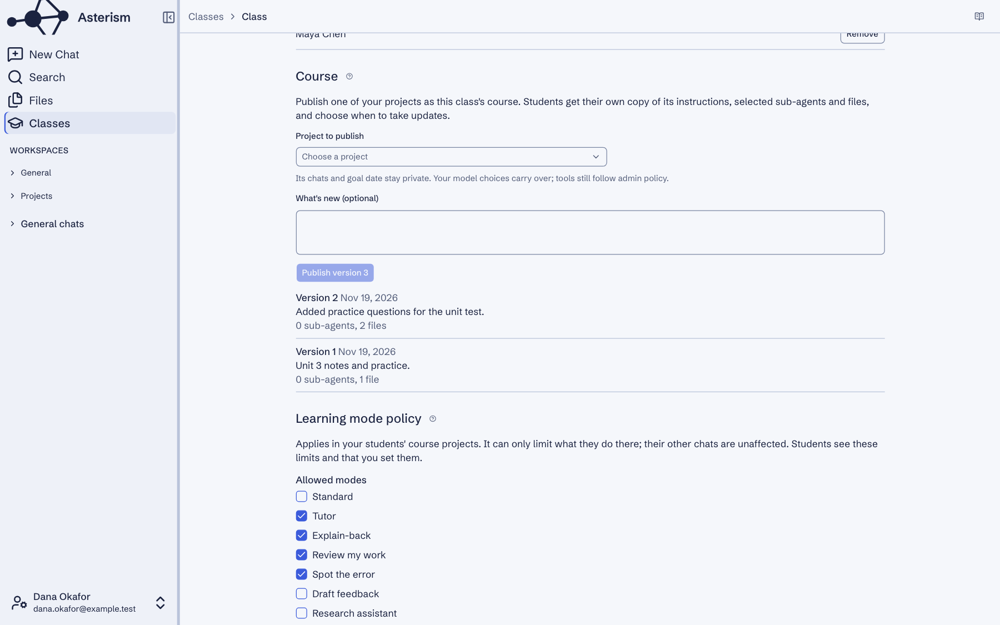

# Class insights

**Where the class struggles** shows which of your course files the class finds
hard, from the flashcard and quiz results of students who choose to share. It's a
way to see what to go over again, without seeing anyone's work.

> **Who can do this:** educators.

## What you see, and what you never see

- **You see** totals, grouped by the course file the practice came from: how the
  class is doing on the cards and quiz questions made from each file.
- **You never see** students' chats, their answers, or any one student's results.

## When insights appear

Sharing is **off** until each student turns it on, with
**Share my practice results in class totals** on their Classes page. Students can
stop sharing at any time.

To protect students, nothing shows until **at least five students share**, and a
file only shows once five of them have practised from it. Until then, the section
says how many share so far.

## Read the insights

1. Open the class and go to **Where the class struggles**.
2. Look for the files with the lowest results. Those are the topics to revisit in
   class, or to add practice material for in a new
   [course version](sharing-a-course.md#publish-a-version).

Only practice on cards and quizzes that came from course files counts. Students'
practice on their own files doesn't.

## Related

- [Running a class](running-a-class.md)
- [Sharing a course](sharing-a-course.md)
