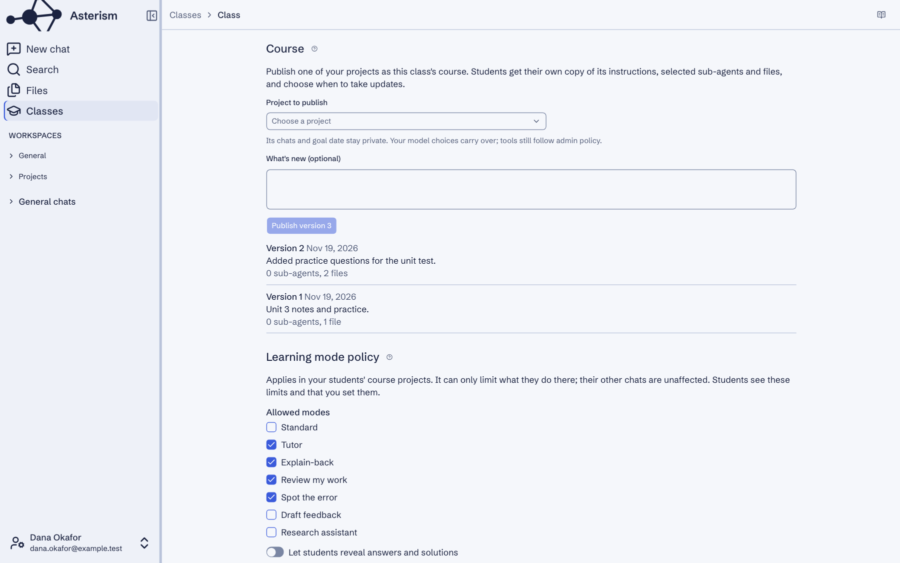
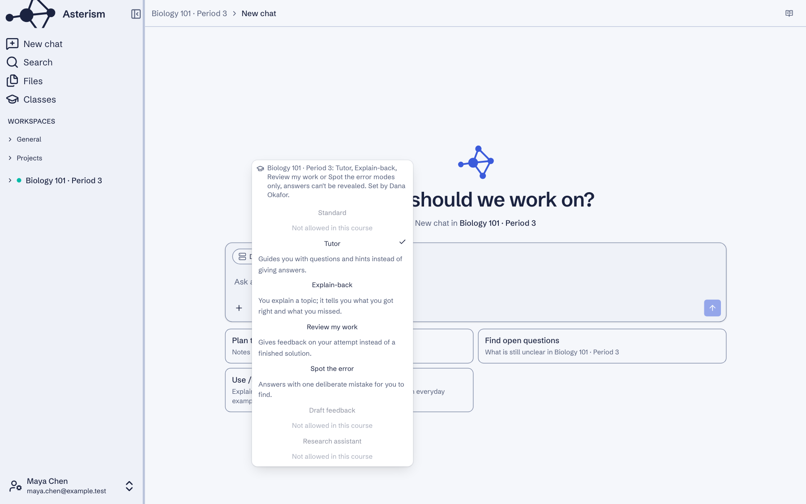

# Setting the class's learning-mode rules

You can decide which [learning modes](../04-learning/learning-modes.md) students
may use in your course, and whether they can see full answers. For example, you
might allow only Tutor and Explain-back while the class practices, so students
work answers out themselves.

> **Who can do this:** educators.

## What the rules cover

- They apply **only in your students' course projects**. Students' other chats
  aren't affected.
- They can only **limit**. They never give students extra modes, tools or files.
- Students see the rules, and that you set them.

## Set the rules

1. Open the class and go to **Learning mode policy**.

   

2. Under **Allowed modes**, tick the modes students may use.
3. Turn **Let students reveal answers and solutions** on or off. Off removes
   **Show answer** (in Tutor mode) and **Show solution** (in Review my work mode)
   from the course project.
4. Select **Save policy**.

Changes apply from each student's next message.

## What students see

In the course project, the mode menu names your rules and who set them, and the
modes you didn't allow are greyed out. Their chats' **Lock mode** window also
lists the rules.

See [Mode restrictions](../04-learning/mode-restrictions.md) for the student's
side.

## Related

- [Sharing a course](sharing-a-course.md)
- [Mode restrictions](../04-learning/mode-restrictions.md)
