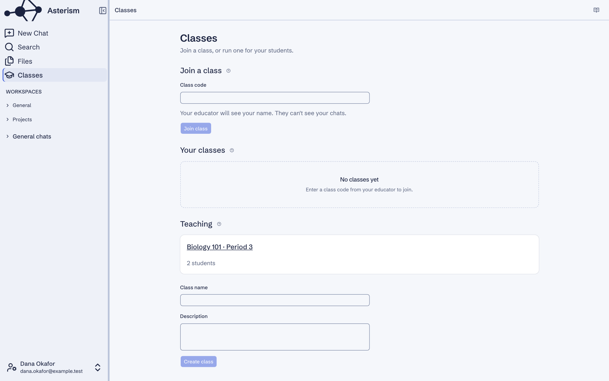
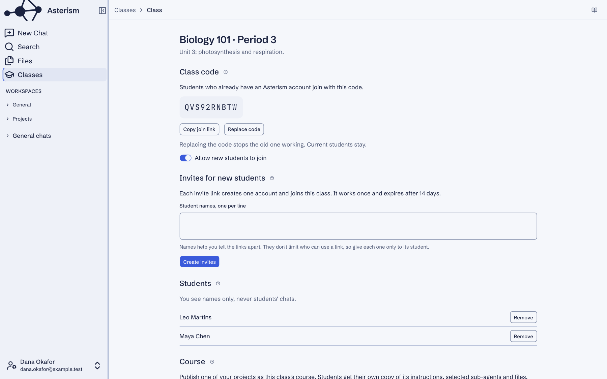
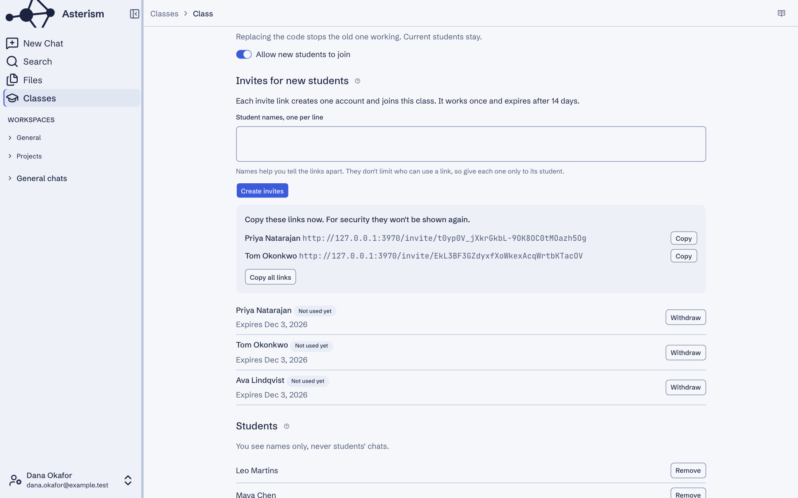

# Running a class

A **class** is a group of students you run in Asterism. You let them in with a
class code or invite links, share course material with them, and set rules for
how they use Asterism in it. This page shows how to become an educator, create a
class and manage who's in it.

> **Who can do this:** educators. Administrators can run classes too.

## Become an educator

1. Select **Classes** in the sidebar.
2. Under **Teaching**, select **Request educator access**.

This sends your name and email to your administrator. The page says
**Your request is waiting for an administrator.** until they approve it.

Educators can create classes. They are not administrators: they get no access to
anyone's chats or files.

## Create a class

1. Select **Classes** in the sidebar.
2. Under **Teaching**, type a **Class name** and, if you like, a **Description**.

   

3. Select **Create class**.

The class appears under **Teaching**. Select its name to open it.

## Let students in

There are two ways in. Use the **class code** for students who already have an
Asterism account, and **invite links** for students who don't.

### The class code

Students with an account type the code under **Join a class** on their Classes
page. **Copy join link** gives you a link that fills the code in for them.

- **Replace code** makes a new code and stops the old one and its links working.
  Students who already joined stay in the class.
- Turn off **Allow new students to join** to stop anyone else joining with the
  code.

### Invite links

Each invite link creates one account and puts that student in the class. It works
once and expires after 14 days.

1. Under **Invites for new students**, type the students' names in
   **Student names, one per line**.
2. Select **Create invites**.

   A link appears for each name.

   

3. Copy each link with **Copy**, or all of them with **Copy all links**, and send
   each one to its student.

**Copy the links straight away: they aren't shown again.** The names only help you
tell the links apart; anyone with a link can use it, so give each one only to its
student.

Under the new links, each invite shows whether it's been used and when it
expires. **Withdraw** stops an unused link working.

What students see when they open a link is in
[Signing in and out](../01-getting-started/signing-in.md#create-your-account-from-an-invite-link).

## Students

**Students** lists who has joined, by name. You never see their chats, files or
answers.

- **Remove** takes a student out of the class. Their own chats and files are
  untouched.
- **Allow back** lets a removed student join again.

## Delete a class

At the bottom of the class page, select **Delete class** and confirm. Students
lose the class, and its code stops working. Their own chats and files are not
affected. This can't be undone.

## Related

- [Sharing a course](sharing-a-course.md)
- [Setting the class's learning-mode rules](class-mode-policy.md)
- [Class insights](class-insights.md)
