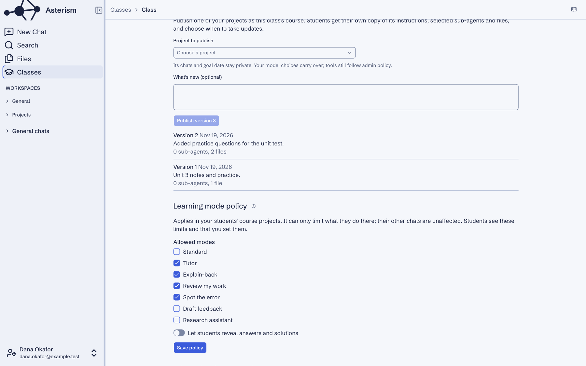
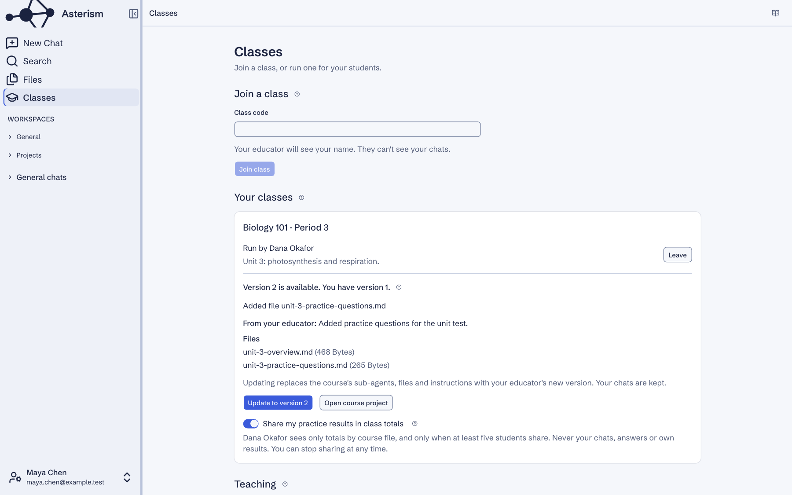
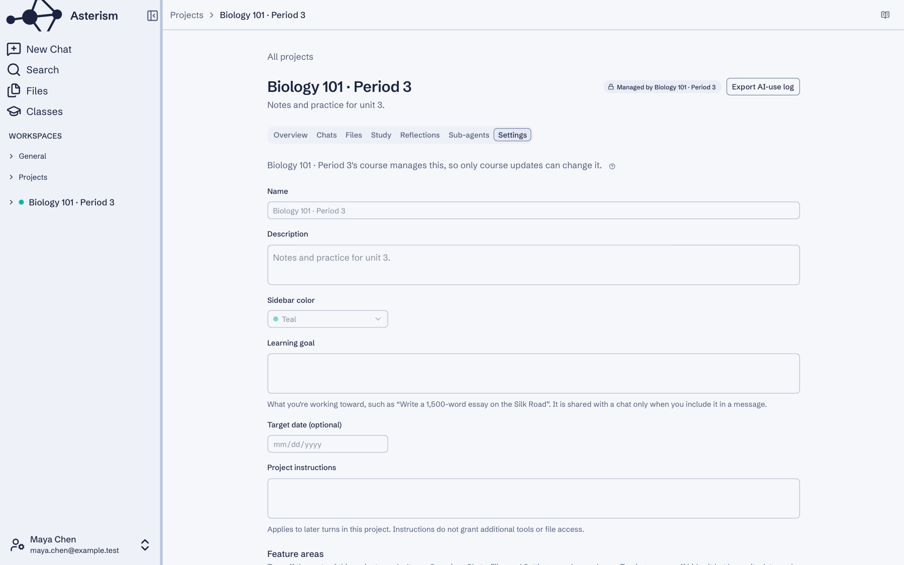

# Sharing a course

A **course** is one of your projects, published to a class. Each student who adds
it gets their own copy, with your project's instructions, selected sub-agents and
files. When you change the project, you publish a new version, and students
choose when to update. This page shows both sides: what you do, and what your
students see.

> **Who can do this:** educators publish courses; students add them.

## Prepare the project

A course is made from a normal [project](../03-files-and-projects/projects.md).
Set it up first:

- **Files**: the handouts, notes and readings students should work from.
- **Settings** › **Project instructions**: how Asterism should help in the course,
  for example "These are Year 11 students; check their understanding with a
  question before explaining."
- **Sub-agents**: any helpers students should have.

Your own chats in the project and its goal date are never published.

## Publish a version

1. Open the class, and go to **Course**.

   

2. Under **Project to publish**, choose the project.
3. Under **What's new**, write a short note for students, such as "Added practice
   questions for the unit test."
4. Select **Publish version**. The button shows the next version number.

Every version is listed below, with its note and how many sub-agents and files it
has.

## What students see

On their **Classes** page, students see the class, who runs it, and the course.

- **Add course** adds their copy of the course as a project in their sidebar.
- When there's a new version, they see what changed and your note, then
  **Update to version** when they're ready. Updating replaces the course's
  instructions, sub-agents and files with the new version. Their chats are kept.

### What students can't change

Their course project is marked **Managed by** and the class name. While they're in
the class, they can't change its settings, instructions, sub-agents or files: only
your course updates change them. They can chat in it, study in it and write
reflections, as in any project.

The course's files also show **Managed by** in the student's Files library, and
they can't delete them there.

### Leaving

To leave a course, a student deletes its project (**Leave course** in the
project's Settings). Their chats move to General, and they can add the course
again from Classes. Leaving the class (**Leave** on the Classes page) keeps the
course project, and it becomes theirs to change.

## Good to know

- You can't see students' chats in the course, or anywhere else.
- If a sub-agent in the course needs a model a student can't use, adding the
  course is blocked for that student until you or an administrator fix it.

## Related

- [Running a class](running-a-class.md)
- [Setting the class's learning-mode rules](class-mode-policy.md)
