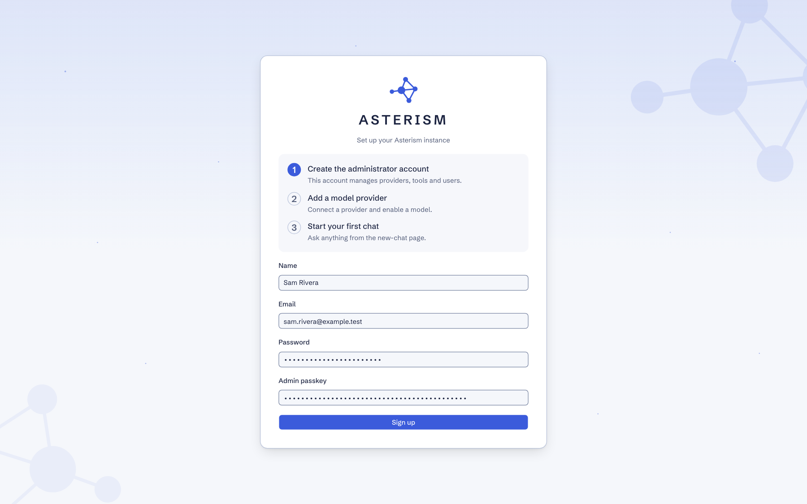
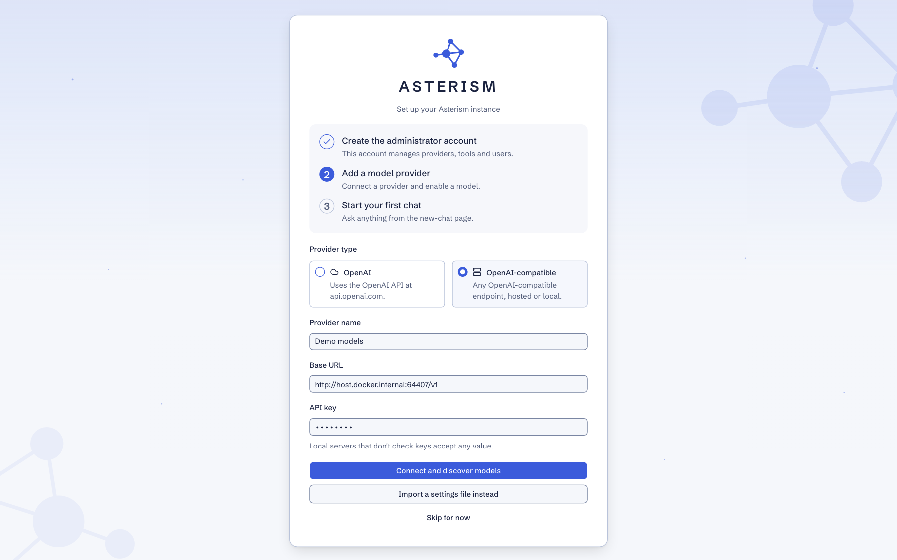
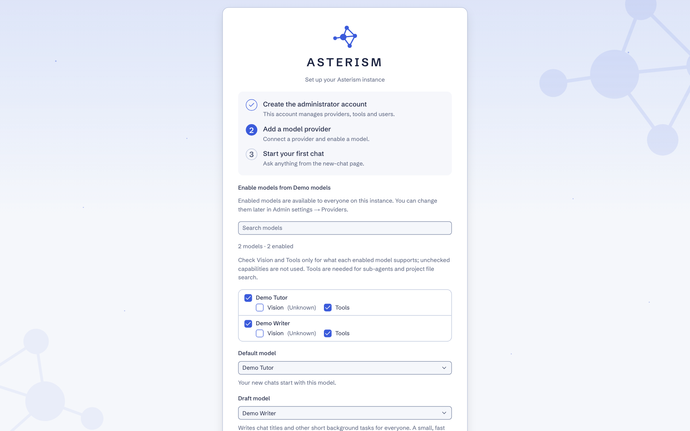
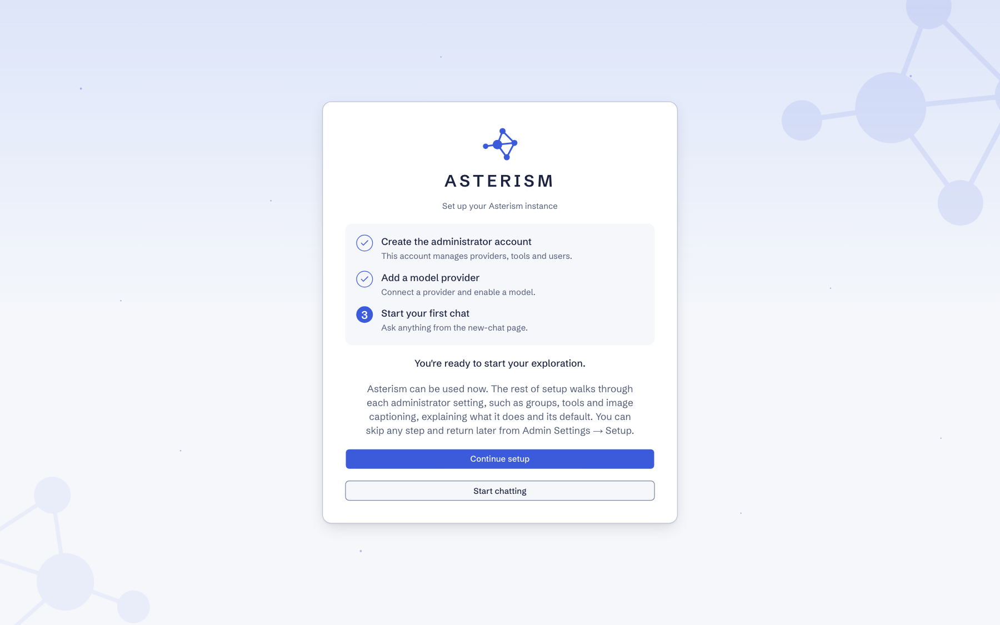
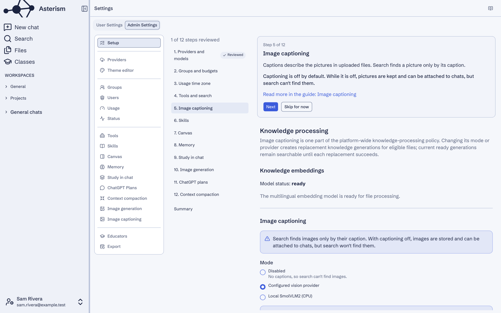
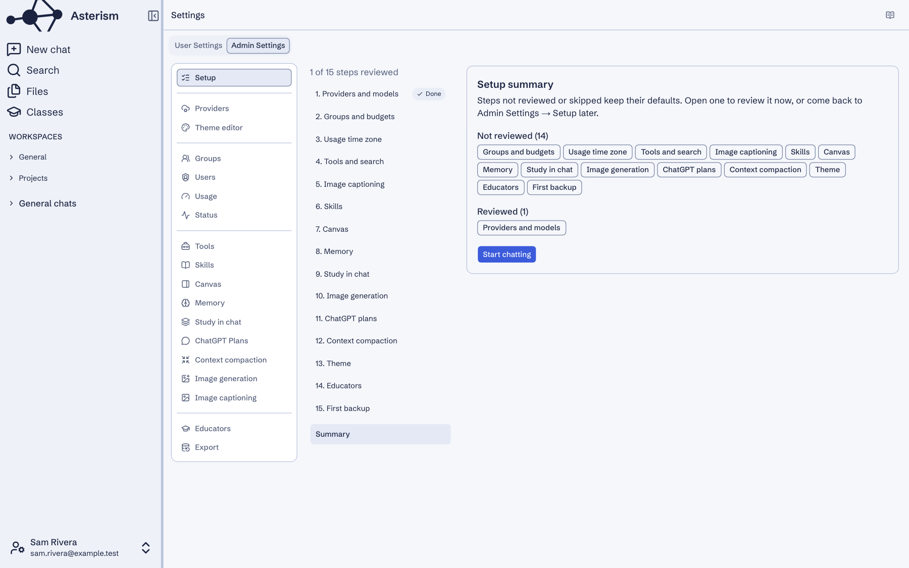

# First-time setup

The first person to open a new Asterism creates the administrator account and
connects the AI models everyone will use. Then the setup walkthrough goes
through every administrator setting in turn, saying what each one does and what
it starts as. This page follows those steps in the browser.

> **Who can do this:** an administrator. The account and model steps happen
> once, when Asterism is new; the walkthrough can be reopened at any time.

Installing and running the server is covered in the
[deployment guide](../../deployment.md): its setup command writes the server's
settings and prints the admin passkey. This page starts when the server is
running and you open its address for the first time.

## Before you start

- **The admin passkey.** The setup command printed it, and it is in the server's
  `.env` file as `ADMIN_PASSPHRASE`. You need it once, to prove you're the
  administrator.
- **A model provider.** For example an OpenAI API key, or the address of an
  OpenAI-compatible server your school runs.

## Step 1: Create the administrator account

1. Open Asterism's address. It says **Set up your Asterism instance**.

   

2. Type your **Name**, **Email** and a **Password**.
3. Type the **Admin passkey**.
4. Select **Sign up**.

## Step 2: Connect a model provider

1. Choose the **Provider type**:
   - **OpenAI** uses the OpenAI API.
   - **OpenAI-compatible** is any other server that works the same way, hosted
     or on your own network.
2. Give the provider a **Provider name** that people will recognize.
3. For OpenAI-compatible, type its **Base URL**.
4. Type the **API key**. A local server that doesn't check keys accepts any value.

   

5. Select **Connect and discover models**. Asterism asks the provider which
   models it has.

Moving from another Asterism? Select **Import a settings file instead** and
choose the file exported from it, with its passphrase.

## Step 3: Enable models

1. Tick the models people may use. For each, tick **Tools** if the model can use
   tools: file search, sub-agents, the canvas and images need it.

   

2. Choose the **Default model**, which new chats start with.
3. Choose the **Draft model**, which writes chat titles and other short background
   tasks for everyone. A small, fast model works best.
4. Select **Continue**.

   

5. Asterism can be used now. The card's list marks **Review the remaining
   settings (optional)** as the current step. Select **Continue setup** to go
   through those settings, or **Start chatting** to do that later.

To connect a provider later instead, select **Skip for now**. You can add
providers and models at any time in **Admin Settings** › **Providers**.

## Step 4: Go through the setup walkthrough

The walkthrough is in **Admin Settings** › **Setup**. It lists every setup step
on the left; Providers and models is already done.

Each step explains what the setting does, what it starts as and what people see
while it is off, with a link to its page in this guide. That setting's own
section is below, the same as in Admin Settings.

1. Change what you need and save it in the section below.
2. Select **Next** to mark the step done, or **Skip for now** to leave it at its
   default. Either way the walkthrough moves on to the next step nobody has
   reviewed.
3. Select any step in the list to go back to it.

Progress is saved on the server and shared by every administrator, so you can
stop at any point: opening **Setup** again resumes at the first step nobody has
reviewed.

The steps, in order:

| Step                 | Starts as                                         |
| -------------------- | ------------------------------------------------- |
| Providers and models | Done in Steps 2 and 3                             |
| Groups and budgets   | Every group may use every model and tool          |
| Usage time zone      | UTC                                               |
| Tools and search     | No tools on                                       |
| Image captioning     | Off: **search can't find pictures until it's on** |
| Skills               | Off                                               |
| Canvas               | Off                                               |
| Memory               | Off                                               |
| Study in chat        | On                                                |
| Image generation     | Off                                               |
| ChatGPT plans        | Off                                               |
| Context compaction   | At 80% of the context window                      |

> **Image captioning and search.** Search finds a picture in an uploaded file
> only by its caption. While captioning is off, pictures are kept and can be
> attached to chats, but search can't find them. See
> [Image captioning](policies.md#image-captioning).

### The summary

Select **Summary** at the end of the step list to see which steps are not
reviewed, skipped or reviewed. Select a step to open it.

## What to do next

- [Users and accounts](users-and-accounts.md): how people get accounts.
- [Groups, budgets and usage](groups-budgets-and-usage.md): limit models or set
  token budgets for students.
- [Policies](policies.md): each feature setting in more detail.
- Take a first backup and schedule nightly ones, as the
  [deployment guide](../../deployment.md) explains. Keep copies of `SYSTEM_KEY`
  and `BETTER_AUTH_SECRET` from the server's `.env` somewhere safe, and not with
  the backups: a backup can only be restored with the `SYSTEM_KEY` it was made
  with.
- [Theme editor](theme-editor.md): make a theme in your school's colors.
- [Educators](policies.md#educators): approve them when someone needs to run
  classes.

## If something goes wrong

- **"The provider returned no models."** Check the base URL (it usually ends in
  `/v1`) and the API key, then try again.
- **The passkey is refused.** Check it with whoever installed Asterism. It's the
  `ADMIN_PASSPHRASE` value in the server's `.env` file.

## Related

- [Providers and models](providers-and-models.md)
- [Policies](policies.md)
