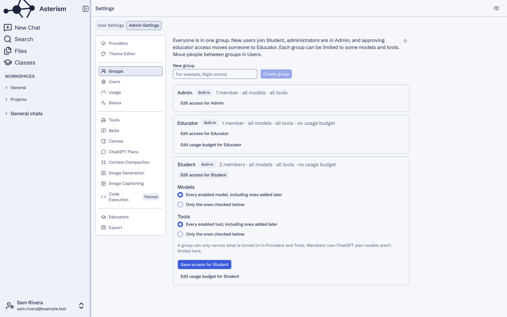
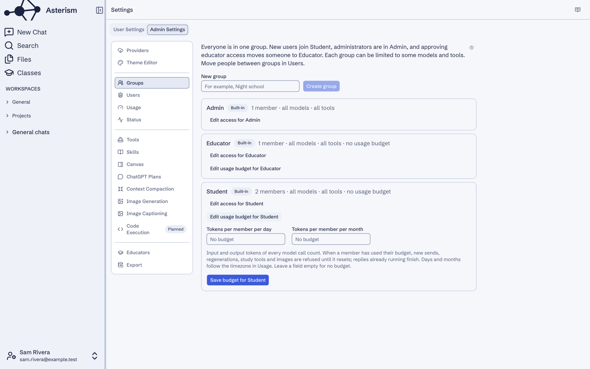
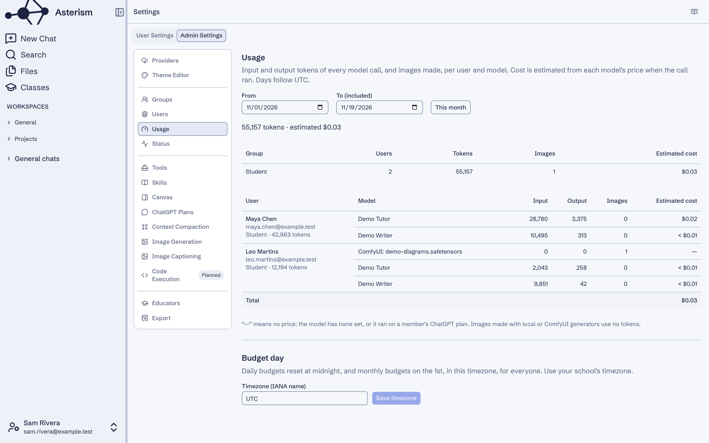
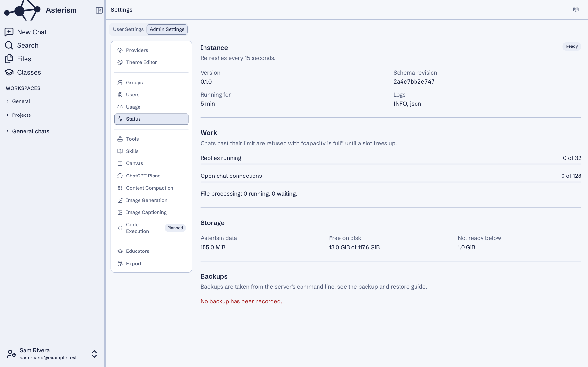

# Groups, budgets, usage and status

Everyone is in exactly one **group**. A group decides which models and tools its
members may use, and how many tokens they may use a day or a month. **Usage**
shows who used what and what it cost, and **Status** shows whether Asterism is
healthy.

> **Who can do this:** administrators.

## Groups

Open **Admin Settings** › **Groups**.

- **Admin**, **Educator** and **Student** are built in. New people join Student;
  administrators are always in Admin; approving educator access moves someone to
  Educator.
- For people who need something different, type a name under **New group**, such
  as "Night school", and select **Create group**. A group you made can be renamed,
  and deleted once it's empty.
- Move people between groups in [Users](users-and-accounts.md#change-someones-group).

### Choose what a group may use

1. Select **Edit access for** and the group's name.
2. Under **Models**, choose **Every enabled model, including ones added later**,
   or **Only the ones checked below** and tick them.
3. Do the same under **Tools**.
4. Select **Save access for** and the group's name.

A group can only narrow what's turned on in [Providers](providers-and-models.md)
and [Tools](policies.md#tools). It doesn't limit members' own ChatGPT plan
models.

### Set a usage budget

A budget limits how many tokens each member of the group may use.

1. Select **Edit usage budget for** and the group's name.

   

2. Type the **Tokens per member per day** and **Tokens per member per month**.
   Leave a box empty for no limit. Both input and output tokens count.
3. Select **Save budget for** and the group's name.

When a member has used their budget, new messages, regenerated answers, study
tools and images are refused until it resets, and the message tells them when.
An answer that's already being written finishes. Administrators never have a
budget.

As a guide, a short chat answer uses a few thousand tokens; a reply that reads
several long files can use tens of thousands. Check [Usage](#usage) after a week
to see what's typical for your students.

## Usage

Open **Admin Settings** › **Usage**.

- Choose the days with **From** and **To (included)**, or **This month**.
- The tables show tokens and images per group, and per person and model, with the
  **Estimated cost**. Cost uses each model's [price](providers-and-models.md#set-prices)
  when the call ran; "—" means the model had no price, or ran on a member's own
  ChatGPT plan.
- Every model call counts: chats, sub-agents, study tools, chat titles and image
  captions.

### Budget day

Under **Budget day**, type your school's time zone in **Timezone (IANA name)**, for
example `Europe/London` or `America/New_York`, and select **Save timezone**.
Budget days start at midnight in that time zone, and months on the 1st.

## Status

Open **Admin Settings** › **Status** to check that Asterism is healthy, without
reading the server's logs. It refreshes every 15 seconds.

- **Instance**: **Ready**, or **Not ready** with what failed. Also the version and
  how long it's been running.
- **Work**: replies running and chat connections open, against their limits, and
  file processing. At a limit, new chats are refused with "capacity is full" until
  a place frees up.
- **Storage**: how much space Asterism's data takes, and the free space on the
  disk. Below the minimum, Asterism stops being ready.
- **Backups**: when the last backup ran. A backup more than two days old, or none
  at all, is shown in red. Backups are taken on the server; see the
  [deployment guide](../../deployment.md).

## Related

- [Users and accounts](users-and-accounts.md)
- [Providers and models](providers-and-models.md)
- [Troubleshooting](../troubleshooting.md)
