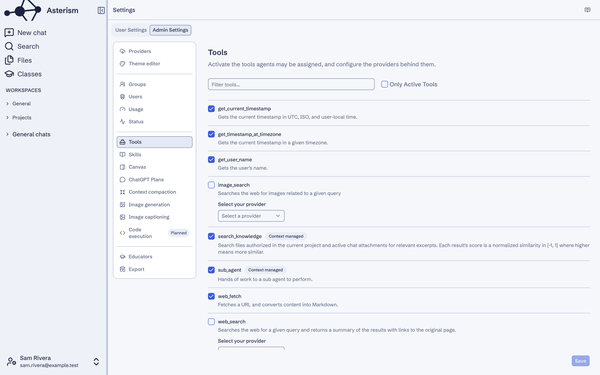
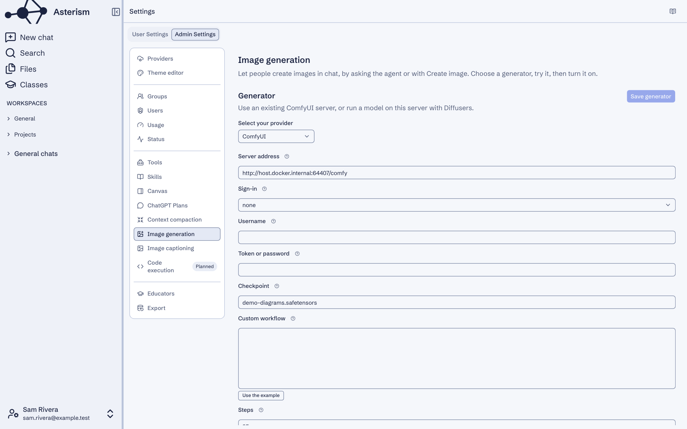

# Policies

The policy pages in **Admin Settings** turn features on and off for everyone, and
configure the services behind them. Most features start **off**, so you choose
what your school uses. This page goes through each one.

> **Who can do this:** administrators.

Each page has its own **Save** button at the bottom (for example
**Save skill policy**). Nothing changes until you select it.

## Tools

**Tools** lists the actions agents may take, such as `web_fetch` (read a web
page) and `web_search` (search the web).

1. Tick a tool to make it available.
2. For `web_search` and `image_search`, choose a provider under
   **Select your provider** and fill in its settings.
3. Select **Save**.

Turning a tool on doesn't give it to anyone yet: each person chooses it for their
own [main agent](../06-making-it-yours/agents.md), and you can limit it by
[group](groups-budgets-and-usage.md#choose-what-a-group-may-use). Tools that act
outside Asterism ask people to [approve](../02-chatting/approving-tool-requests.md)
each use.

Tools marked **Context managed**, such as `search_knowledge` (file search) and
`sub_agent`, are used automatically when they apply.

## Skills

Turn on **Enable skill activation** to let people use their
[skills](../06-making-it-yours/skills.md) in chats with `/`. Skills only add
instructions; enabling them gives nobody tools, files or delegation. Turning them
off later keeps everyone's skill documents.

## Canvas

Turn on **Enable canvas** to let Asterism put long documents, code and web pages
in a [panel beside the chat](../02-chatting/canvas.md). Each person must also turn
it on in their own settings, and the chat's model must support tools. Turning it
off stops writing to the canvas at once; existing canvas items stay readable and
downloadable.

## Memory

Turn on **Enable memory** to let Asterism keep in mind what helps it work with
each person, such as how they learn best, across their chats and projects. It's
off until you turn it on. Turn on **Limit to selected groups** and tick groups to
offer it to those groups only.

Memories are private: only the person they belong to can see them, not
educators and not administrators. Each person can also turn memory off in
**Your Asterism**, and an educator can turn it off for a course. People can still
see and delete their memories while memory is off.

## ChatGPT Plans

Turn on **Allow ChatGPT plan connections** to let people
[connect their own ChatGPT plan](../06-making-it-yours/connecting-chatgpt.md).
Sign-in only works when the person's browser runs on the computer that runs
Asterism, so this is mainly useful for a personal installation. Turning it off
makes plan models unavailable; existing chats and sub-agents keep their choice.

## Context compaction

Controls how long chats are [summarized](../02-chatting/long-conversations.md) so
they keep working.

- **Compact at (% of the context window)**: compaction runs before a message that
  would go over this share of the model's limit. Between 50 and 95; the default is 80.
- **Recent turns kept in full**: how many of the latest messages, with their
  answers, are always sent word for word.
- **Fallback context window (tokens)**: used for models whose limit is unknown.
  Set the real limit on each model in [Providers](providers-and-models.md) instead
  when you can.
- **Compaction model**: **Each chat's own model**, or one model for every summary.

Select **Save compaction settings**.

## Image generation

Lets people [create images](../02-chatting/creating-images.md) in chat.

1. Under **Generator**, choose what makes the images:
   - **ComfyUI**: an existing ComfyUI server. Fill in its **Server address** and
     **Checkpoint** (the model file it uses). Test the connection to list the
     server's checkpoints.
   - **ONNX**: runs a small model on the Asterism server's processor, with no
     GPU, in every version of Asterism. Under **ONNX models**, download a model
     that fits the server's memory, then select **Use this model**. LCM
     DreamShaper v7 is the default; SDXL Turbo makes sharper pictures but needs
     more memory, and you accept its license (the Stability AI Community License)
     before it downloads. An image takes a few seconds on a fast server.
   - **Diffusers**: runs larger models on the server's GPU. It is only in the
     [GPU build](../../deployment.md#gpu-build) of Asterism; elsewhere **Local
     models** says it isn't available. The page shows the server's hardware and
     which models fit it. Read a model's license before you download it: some
     can't be used commercially.
2. Select **Save generator**.
3. Under the generator, type a **Prompt** and select **Generate a test image** to
   check it works. The picture goes into your Files.
4. Under availability, turn on **Enable image generation**. To limit it, turn on
   **Limit to selected groups** and tick the groups.
5. Select **Save availability**.

Every request is recorded, and some requests are always refused, such as sexual
content involving minors.

## Image captioning

Captions describe pictures in uploaded files, so they can be searched.

- **Disabled**: no captions.
- **Configured vision provider**: a model that can read images writes them. Choose
  the **Vision model**. Pictures are sent to that model's provider, so only choose
  this if that's acceptable for your school's files.
- **Local SmolVLM2 (CPU)**: a small model on the Asterism server writes them.

Changing the mode reprocesses pictures. Files stay searchable while that happens.

## Code execution

Marked **Planned**: running code isn't available yet.

## Educators

Approves who may run classes. See
[Users and accounts](users-and-accounts.md#educators).

## Export

Moves every application setting to another installation in one file: providers,
models, tools, policies and each group's model and tool access. Users, group
membership, chats and files are **not** included.

- **Export settings**: type a **Passphrase** of at least 12 characters, twice, and
  select **Export settings**. The file contains your provider API keys, encrypted
  with the passphrase. Keep it safe: without it, nobody can open the file.
- **Import settings**: choose the **Settings file**, type its **File passphrase**
  and select **Preview import** to see what will change before you apply it.
  Providers in the file are added, or updated when the name matches; settings in
  the file replace current values. Nothing is removed.

## Related

- [Groups, budgets and usage](groups-budgets-and-usage.md)
- [Theme editor](theme-editor.md)
