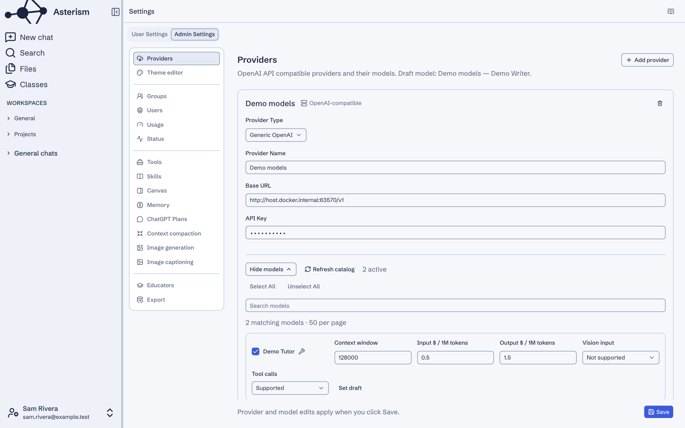

# Providers and models

A **provider** is a service that runs AI models, such as OpenAI or a server your
school hosts. You connect providers and choose which of their models people can
pick. This page also explains how to set a model's price, so usage costs can be
estimated.

> **Who can do this:** administrators.

Open **Admin Settings** › **Providers**: select your name, then **Settings**, then
the **Admin Settings** tab.

## Add a provider

1. Select **Add provider**.
2. Choose the **Service**: **OpenAI**; a hosted API, aggregator or local server,
   which fills in its **Provider Name** and **Base URL**; or **Custom
   OpenAI-compatible URL** for any other server. Check the name and URL, and
   fill in the **API Key**: required for OpenAI, hosted APIs and aggregators,
   optional for a local server or custom URL. To remove a saved key, clear the
   field and save; leaving the hidden key as it is keeps it. Changing the service later keeps a name or URL you
   typed yourself.
3. Select **Save** at the bottom of the page.

Edits on this page only apply when you select **Save**.

## Choose models

1. Under a provider, select **Browse** and the number of models (for example
   **Browse 2 models**) to see the models it offers.
   **Refresh catalog** asks the provider again for new models.
2. Tick the models people may use. **Select All** and **Unselect All** do every
   model at once.
3. For each model you enable, check:
   - **Context window**: how many tokens it can read at once. Set it to the real
     value, so [context compaction](policies.md#context-compaction) starts at
     the right time.
   - **Vision input**: whether it can look at pictures.
   - **Tool calls**: whether it can use tools. File search, sub-agents, the canvas
     and image creation need it.
4. Select **Save**.

People see a wrench beside models that can use tools, and a picture beside
models that can read images.

### The draft model

**Set draft** chooses the model that writes chat titles and other short
background tasks for everyone. A small, fast model works best. The current one
is named at the top of the page.

### Turning a model off

Untick a model and save. People can't choose it any more. Chats and sub-agents
that used it keep their choice but show it as unavailable, so people know to
choose another. Asterism never switches them to a different model by itself.

## Set prices

Prices let Asterism estimate costs on the [Usage](groups-budgets-and-usage.md#usage)
page. They don't limit anything.

1. Find the model under its provider.
2. Type the provider's prices in **Input $ / 1M tokens** and
   **Output $ / 1M tokens**: what it charges per million tokens read and written.
3. Select **Save**.

A price applies to calls made from then on. Leave the fields empty for a model
with no cost, such as one on your own server.

## Remove a provider

Select the bin at the top right of its card, then **Save**.

## Related

- [First-time setup](first-time-setup.md)
- [Groups, budgets and usage](groups-budgets-and-usage.md)
