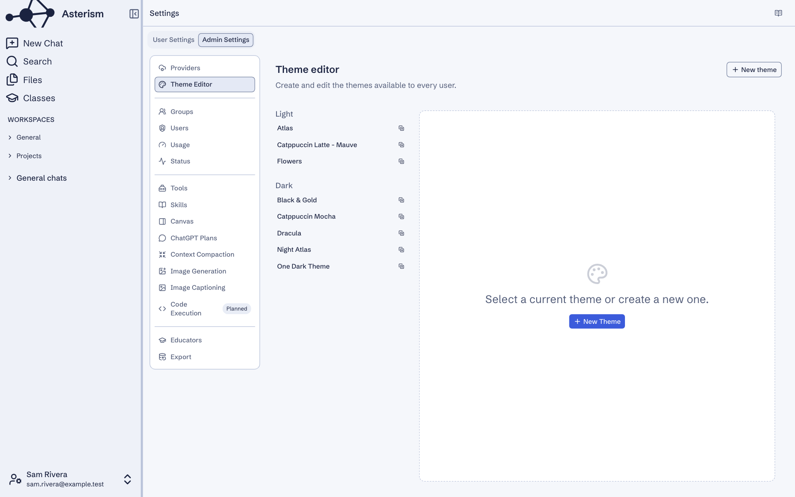

# Theme editor

The **Theme editor** creates and edits the color themes that everyone can choose
in their [General settings](../06-making-it-yours/general-settings.md#appearance).

> **Who can do this:** administrators.

Open **Admin Settings** › **Theme Editor**.

## Start a theme

- Select a theme's name to edit it.
- Select the copy button beside a theme (**Duplicate**) to start a new one from it.
  This is the easiest way to make a theme in your school's colors.
- Select **New theme** to start from scratch.

## Edit a theme

1. Set the **Name** and the **Type**: **Light** or **Dark**.
2. Select a color swatch to change it, either with the picker or by typing its hex
   code (such as `#2f5bd8`).
3. Adjust the **Corner radius (rem)**, **Shadows** and **Density**
   (**Comfortable** or **Compact**) if you like.
4. Check the preview beside the form, then select **Save**.

People can choose the theme in their own settings as soon as it's saved.
Changing a theme changes it for everyone using it.

## Good to know

- Make sure text is easy to read on the colors you choose: check the preview's
  buttons, text and input.
- Themes are listed under **Light** or **Dark**, by their type.

## Related

- [Policies](policies.md)
- [General settings](../06-making-it-yours/general-settings.md)
