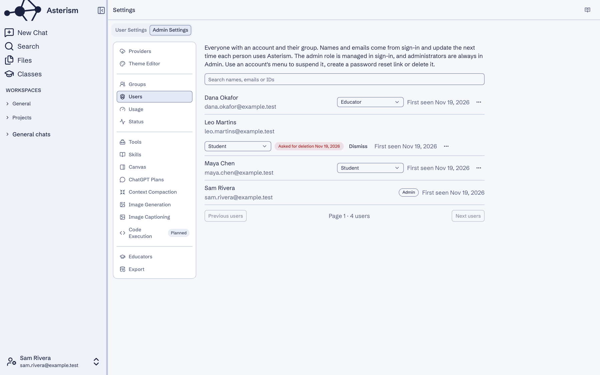
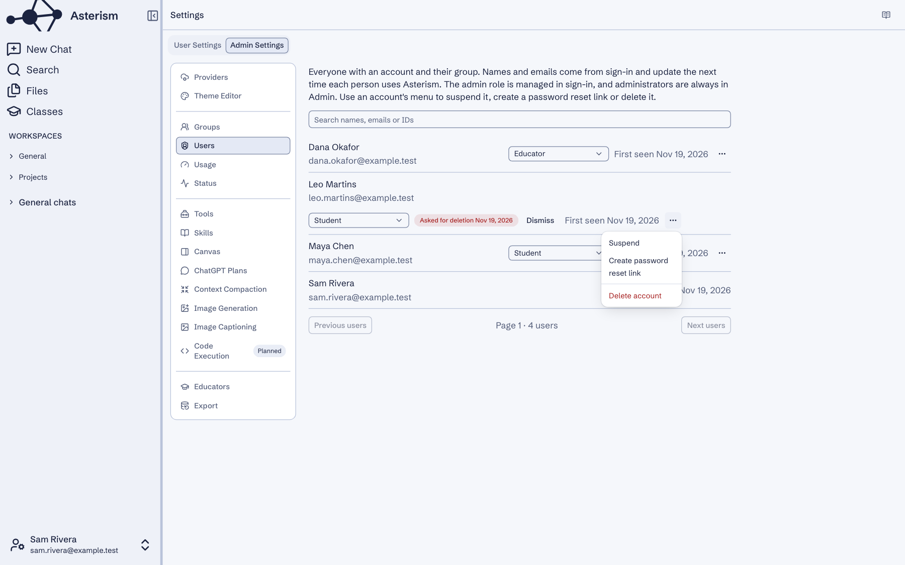
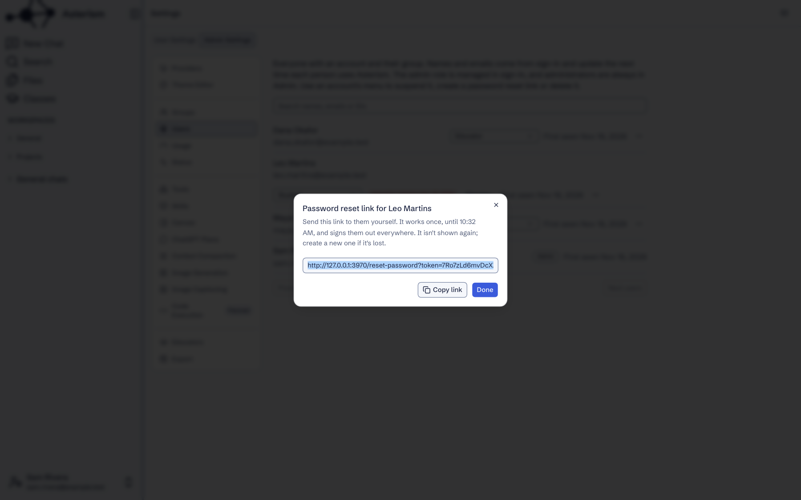
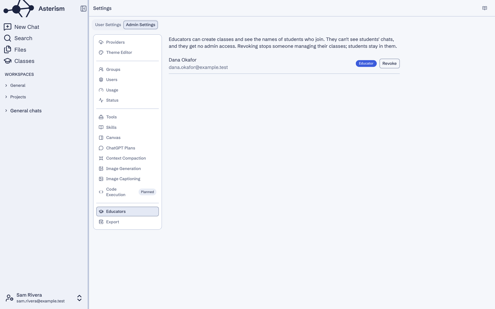

# Users and accounts

**Admin Settings** › **Users** lists everyone with an account. From here you move
people between groups, suspend and reactivate accounts, create password reset
links, and delete accounts. **Admin Settings** › **Educators** decides who may run
classes.

> **Who can do this:** administrators.

## How people get accounts

People can't sign up by themselves. Accounts are created from **class invite
links**, which educators make for their students (see
[Running a class](../07-for-educators/running-a-class.md#invite-links)).
Administrators can run classes too, so you can create a class to invite people
who aren't students. New accounts join the **Student** group.

## Find someone

Type part of a name, email or user ID in **Search names, emails or IDs**.

Names and emails come from sign-in, and update the next time the person uses
Asterism.

## Change someone's group

Choose another group in the menu beside their name. Their group decides which
models and tools they may use (see
[Groups, budgets and usage](groups-budgets-and-usage.md)).

- Moving someone into **Educator** gives them educator access; moving them out
  takes it away.
- Administrators are always in **Admin**.

## Account actions

Select the **…** button beside an account.

### Suspend and reactivate

**Suspend** blocks an account without deleting anything. The person is signed out
everywhere and can't sign in; their running chats and file processing stop.
Confirm with **Suspend**.

To let them back in, open the same menu and select **Reactivate**.

Use this for a lost device, a compromised account, or a student who's left but
whose work you need to keep.

### Create a password reset link

People can't reset their own password. When someone forgets theirs:

1. Select **Create password reset link**.

   

2. Select **Copy link** and send it to them yourself, for example by email.

The link works once, and only until the time it shows. Using it signs them out
everywhere. It isn't shown again; create a new one if it's lost. What they see is
in [Signing in and out](../01-getting-started/signing-in.md#set-a-new-password).

### Delete an account

**Delete account** removes the person's sign-in and everything they own in
Asterism: chats, projects, files, study material, skills, sub-agents, settings and
About you. They leave their classes, and any class they teach is deleted for
everyone in it. **This can't be undone.** To keep their data, suspend the account
instead.

## Deletion requests

People can ask for their account to be deleted, in their **Settings** ›
**General**. Their row then says **Asked for deletion** and the date.

- To agree, ask them to [download their data](../06-making-it-yours/your-data-and-account.md#download-your-data)
  if they want it, then delete the account as above.
- To decline, select **Dismiss**.

Nothing happens until you act. An administrator can't ask to delete their own
account; another administrator deletes it.

## Educators

Educators create and run classes. They see the names of students who join, never
their chats, and they get no admin access.

People ask from their Classes page with **Request educator access**. Open
**Admin Settings** › **Educators** to see requests and educators.

- **Approve** a request to move them into the Educator group, or **Deny** it.
- **Revoke** moves an educator back to Student. They can no longer manage their
  classes; the students stay in them.

## Related

- [Groups, budgets and usage](groups-budgets-and-usage.md)
- [Running a class](../07-for-educators/running-a-class.md)
