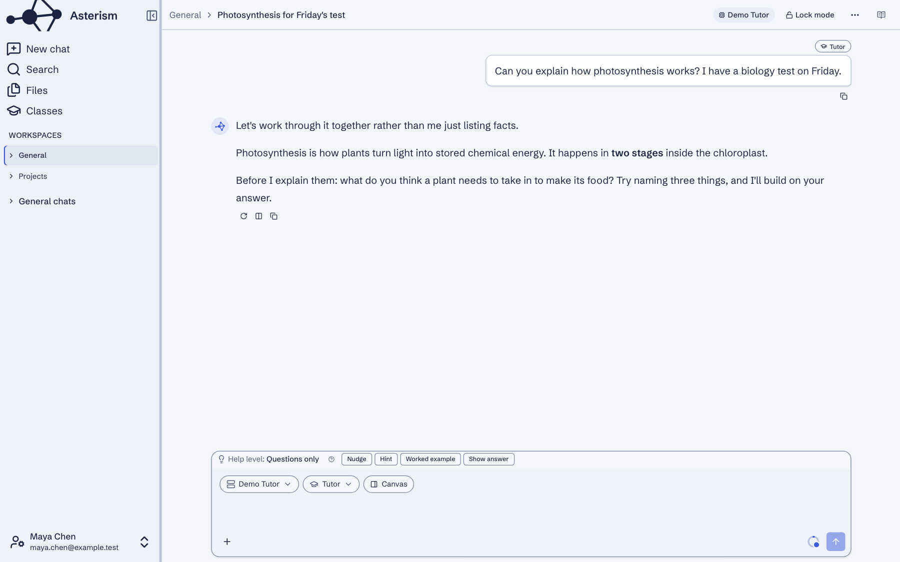

# Asterism user guide

Asterism is an AI assistant built to help you learn. You can ask it questions,
give it your notes and handouts to work from, practise with flashcards and
quizzes, and choose how it helps: it can guide you with questions instead of
handing you the answer.

This guide shows you how to use it, one task at a time, with pictures of each
screen. You don't need to know anything about AI or computers beyond using a web
browser.

## How to use this guide

- **New to Asterism?** Start with [Getting started](#getting-started), then read
  the chapters you need. You don't have to read them in order.
- **Looking for a word?** The [glossary](glossary.md) explains the terms the app
  uses.
- **Something not working?** _Troubleshooting_ lists the messages you might see
  and what to do about them.

Pages for educators and administrators say so at the top. Everything else is for
everyone.

The people, files and conversations in the pictures are invented. Your screen may
look a little different if your administrator has chosen another theme or limited
what your group can use.

## Getting started

1. [What Asterism is](01-getting-started/what-is-asterism.md): what it can help
   you with, and what to keep in mind.
2. [Signing in and out](01-getting-started/signing-in.md): creating your account
   from an invite link, signing in, setting a new password and signing out.
3. [Finding your way around](01-getting-started/finding-your-way-around.md): the
   sidebar, your chats and projects, settings and help, on a computer and a phone.
4. [Your first chat](01-getting-started/your-first-chat.md): asking a question,
   choosing a model, stopping an answer and what Asterism shows while it works.
5. [Getting help](01-getting-started/getting-help.md): the Help center, help for
   each page, help icons and the chat tour.

## Chapters

The other chapters are being written. Each one will appear here when it is ready.

| Chapter               | What it covers                                                                        |
| --------------------- | ------------------------------------------------------------------------------------- |
| Chatting              | Choosing models, attaching files, sources, branches, the canvas, images and templates |
| Files and projects    | Your file library, projects, sub-agents and team packs                                |
| Learning              | Learning modes, hints, reflections, your AI-use log and rubrics                       |
| Studying              | Flashcards, practice quizzes, summaries, study guides and your progress               |
| Making Asterism yours | Your settings, About you, agents, skills, templates and your data                     |
| For educators         | Classes, invites, courses, learning-mode rules and class insights                     |
| For administrators    | First-time setup, providers, users, groups and budgets, usage, policies and themes    |
| Troubleshooting       | Common messages and what to do                                                        |

## For people writing this guide

[Writing the user guide](CONTRIBUTING.md) explains the voice, the page outline and
how to make the screenshots.
