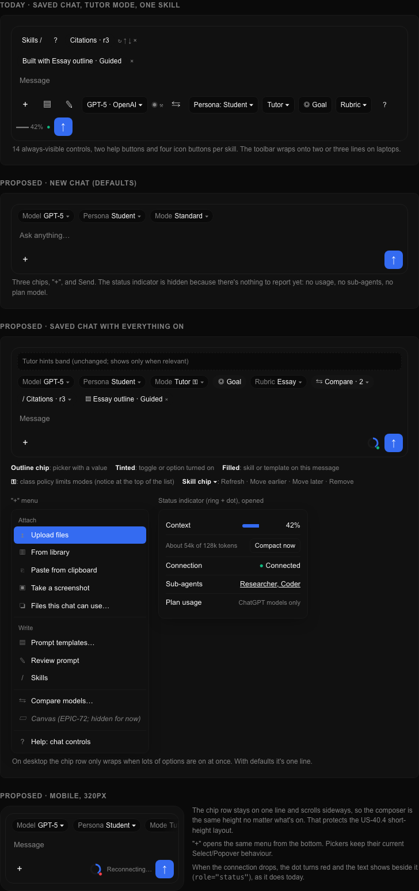

# US-73.1: Composer layout proposal

Status: approved by the user on 2026-11-08, including the single "+" menu and always-visible Model, Persona and Mode chips. Epic: [EPIC-73](../epics/EPIC-73-COMPOSER-CLEANUP.md).

The composer is `ChatInput` (`apps/frontend/src/features/chat/components/chat-input.tsx`).
It is used on the new-chat page (`app/(main)/page.tsx`) and in saved chats
(`chat-session.tsx`). Both pass their pickers through the `modelSelector` slot
and their indicators through the `status` slot.

## Inventory (today)

Rows are listed top to bottom as they render now.

| # | Control | Where now | When it shows | Proposed place |
|---|---|---|---|---|
| 1 | Tutor hint controls (`ChatHintControls`) | Above the input, saved chats | Learning mode offers hints and the chat has messages | Unchanged: contextual band above the input |
| 2 | Attachment chips, retry, discard | Top of the input | Files attached | Unchanged: contextual band |
| 3 | Upload and send errors | Top of the input | On failure | Unchanged: contextual band |
| 4 | "Skills /" button | Skills row | Always (with an owner) | "+" menu → Skills |
| 5 | Skills help (?) | Skills row | Always | Folded into "Chat controls" help |
| 6 | Active skill chips + refresh, move up, move down, remove (4 icon buttons each) | Skills row | Skills active | Top row: one chip per skill; the chip opens a menu with Refresh, Move earlier, Move later, Remove |
| 7 | "Skill changes apply…" status line | Below skill chips | Skills changed | Unchanged (below the top row) |
| 8 | "Built with <template>" label + remove | Own row | Template applied | Top row chip with a remove (×) |
| 9 | Prompt coach panel | Above the text box | Review open | Unchanged: contextual band |
| 10 | Message text box (slash list) | Middle | Always | Unchanged |
| 11 | Attach menu ("+": upload, library, paste, screenshot, files this chat can use) | Toolbar | Always | "+" menu → Attach group |
| 12 | Prompt templates button | Toolbar | With an owner | "+" menu → Prompt templates |
| 13 | Review prompt button | Toolbar | Prompt coach turned on | "+" menu → Review prompt |
| 14 | Model picker (with provider) | Toolbar | Always | Top row: Model chip (always) |
| 15 | Model capability icons | Toolbar, after the model | A model is selected | Inside the model picker list and the chip tooltip |
| 16 | ChatGPT plan usage | Toolbar | ChatGPT plan model selected | Status popover |
| 17 | Model load error / no models / model unavailable notices | Toolbar, full-width line | On error | Unchanged: alert line under the top row |
| 18 | Compare models (icon, or "Compare · n") | Toolbar | Always | "+" menu → Compare models…; top row chip "Compare · n" only while active |
| 19 | Persona picker (+ change error) | Toolbar | Always | Top row: Persona chip |
| 20 | Learning mode picker (+ change error) | Toolbar | Always | Top row: Mode chip |
| 21 | Course policy notice | Toolbar, full-width line | Project belongs to a class with a mode policy | Lock badge on the Mode chip; the full notice heads the mode list |
| 22 | Goal toggle | Toolbar | Project has a learning goal | Top row: Goal chip (toggle) |
| 23 | Rubric picker | Toolbar | Mode takes a rubric | Top row: Rubric chip |
| 24 | Chat controls help (?) | Toolbar | Always | "+" menu → Help: chat controls |
| 25 | General sub-agents indicator | Toolbar, right | General chat with sub-agents chosen | Status popover (row with link to settings) |
| 26 | Context usage meter + "Compact now" | Toolbar, right | Saved chat with usage and a known window | Status indicator (ring) and popover |
| 27 | Connection indicator | Toolbar, right | Saved chats | Status indicator dot; text appears beside it when not connected |
| 28 | Send / Stop | Toolbar, right | Always | Unchanged |
| 29 | Drag-and-drop overlay | Over the composer | Dragging files | Unchanged |

## Proposed layout

Three bands inside the existing `ChatInputContainer`:

1. **Top row (context chips).** One line. Model, Persona and Mode chips always
   show because they always have a value and the first-chat tour points at them.
   Goal, Rubric, Compare, skill and template chips show only when they apply.
   Chips are small outline buttons (`Badge`-styled triggers) that open the
   existing pickers. On narrow screens the row scrolls sideways instead of
   wrapping, so the 320px short-height layout keeps its height.
2. **Text box.** Unchanged, including the slash list, Enter / Shift+Enter and paste.
3. **Action row.** "+" on the left; the status indicator and Send/Stop on the right.

Contextual bands (hints, attachments, errors, prompt review, model notices)
stay where they are; they appear only when needed.

### "+" menu (`DropdownMenu`)

- **Attach:** Upload files, From library, Paste from clipboard, Take a screenshot,
  Files this chat can use…
- **Write:** Prompt templates…, Review prompt (when the coach is on), Skills /
- **Compare models…** (opens the existing compare popover anchored to the composer)
- **Canvas** — reserved slot for EPIC-72; hidden until it lands.
- **Help: chat controls**

One "+" replaces both the attach button and a separate options button. The
epic sketched them apart; merging them keeps the action row to three controls.

### Status indicator (`Popover`)

A small ring showing context usage, with a dot for connection. When everything
is fine it is quiet; when disconnected the dot turns red and the text
("Reconnecting…") shows beside it as today, with `role="status"`. The popover
lists: context usage with "Compact now", connection, General sub-agents (with
the settings link), and ChatGPT plan usage when relevant. On the new-chat page
it shows only when there is something to show (sub-agents or plan usage).

### Accessibility and keyboard

- Every chip and menu item is a real button/menu item with the current label
  (for example "Chat model", "Chat persona", "Learning mode", "Rubric",
  "Include learning goal"), so existing tests and screen-reader names stay.
- The "+" menu keeps the name "Add attachments" → renamed "More options";
  E2E selectors change accordingly.
- Slash commands, Enter/Shift+Enter, Escape and existing shortcuts are unchanged.
- Tour anchors: `model`, `persona`, `learning-mode` move with their chips;
  `attachments` moves to the "+" button. Tour copy changes "buttons below the
  box" to "chips above the box and the + menu".

### Help updates (US-73.2)

`composer.controls` and the chat guide describe: the top row chips, the "+"
menu groups, and the status indicator.
Mockup: 
